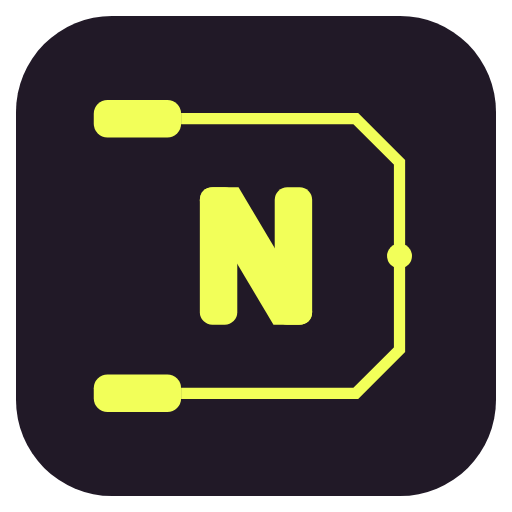
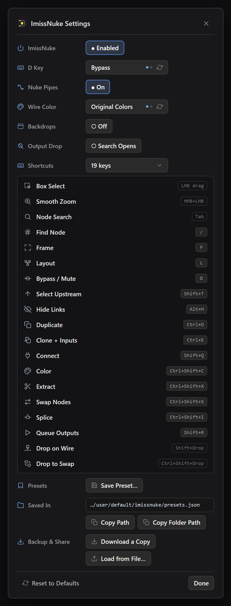

<p align="center"></p>

<h3 align="center">Miss Nuke's node graph? Bring it to ComfyUI.</h3>

<p align="center">Nuke hotkeys, pipes and backdrops for ComfyUI · free and open source · no dependencies</p>

## Installation

Search **ImissNuke** in ComfyUI Manager, or:

```bash
cd ComfyUI/custom_nodes
git clone https://github.com/jorge-miranda-cherem/comfyui-imissnuke.git
```

Restart ComfyUI. The yellow **N** in the top bar opens the settings. Right-click it to turn ImissNuke on or off.

<p align="center"></p>

## Shortcuts

| Key | Action | |
| :-- | :-- | :-- |
| <kbd>Tab</kbd> | Node Search | Search at the cursor |
| <kbd>/</kbd> | Find Node | Jump to a node by number or name |
| <kbd>F</kbd> | Frame | Fit the selection, or the whole graph |
| <kbd>L</kbd> | Layout | Line up the selection along its wires |
| <kbd>D</kbd> | Bypass / Mute | The **D Key** setting picks which one |
| <kbd>Shift</kbd> <kbd>↑</kbd> | Select Upstream | Add what feeds the selection; again for one more level |
| <kbd>Alt</kbd> <kbd>H</kbd> | Hide Links | Hide input wires, or Set & Get links |
| <kbd>Ctrl</kbd> <kbd>D</kbd> | Duplicate | A copy without wires |
| <kbd>Ctrl</kbd> <kbd>E</kbd> | Clone + Inputs | A copy that keeps its input wires |
| <kbd>Shift</kbd> <kbd>Q</kbd> | Connect | Wire the selection into the node on the right |
| <kbd>Ctrl</kbd> <kbd>Shift</kbd> <kbd>C</kbd> | Color | Color palette for nodes and groups |
| <kbd>Ctrl</kbd> <kbd>Shift</kbd> <kbd>X</kbd> | Extract | Pull a node out and bridge its wires |
| <kbd>Ctrl</kbd> <kbd>Shift</kbd> <kbd>S</kbd> | Swap Nodes | Two selected nodes trade places and wires |
| <kbd>Ctrl</kbd> <kbd>Shift</kbd> <kbd>I</kbd> | Splice | Put a node into a wire |
| <kbd>Shift</kbd> <kbd>R</kbd> | Queue Outputs | Run only the selected outputs |
| <kbd>Shift</kbd> + drop | Drop on Wire | Drop a dragged node on a wire to splice it in |
| <kbd>Ctrl</kbd> <kbd>Shift</kbd> + drop | Drop to Swap | Drop a dragged node on another to swap them |
| MMB + LMB drag | Smooth Zoom | Wacom: pen tip + side button |

**Remap any key** from the panel: click its key, press the new one. A key already in use trades places.

## Settings

**D Key** Bypass or Mute · **Nuke Pipes** straight wires with 45° bends · **Wire Color** type colors or all black ·
**Node Color** a colored header over a dark body, or the whole node (switching moves the colored nodes of the open graph too) ·
**Backdrops** groups drawn as Nuke backdrops · **Output Drop** what a wire dropped on empty canvas does.

Hover any row in the panel for a one-line tip.

## Presets

**Save Preset…** keeps your settings and keys under a name. They are saved to
`ComfyUI/user/default/imissnuke/presets.json`, and the **Saved In** row shows the full path.
**Download a Copy** and **Load from File** take them to another computer or a teammate.

**One ComfyUI for many people.** A page that carries ImissNuke can keep the file for each person
instead, the way it keeps the Hotbox's: set `window.__imissNukeFiles = { folder(), read(name), write(name, obj) }`
before ImissNuke loads. `folder()` answers `{ folder, ready, why }`, `read('presets.json')` gives the
saved object (or `null` when there is none yet) and `write('presets.json', obj)` saves it. Until
`ready`, the presets stay in the browser and are written when the folder can be reached; call
`window.__imissNukePresets.filesChanged()` when that changes.

## More

[MIT License](LICENSE) · Nuke is a trademark of The Foundry Visionmongers Ltd. ImissNuke is not affiliated with Foundry.
